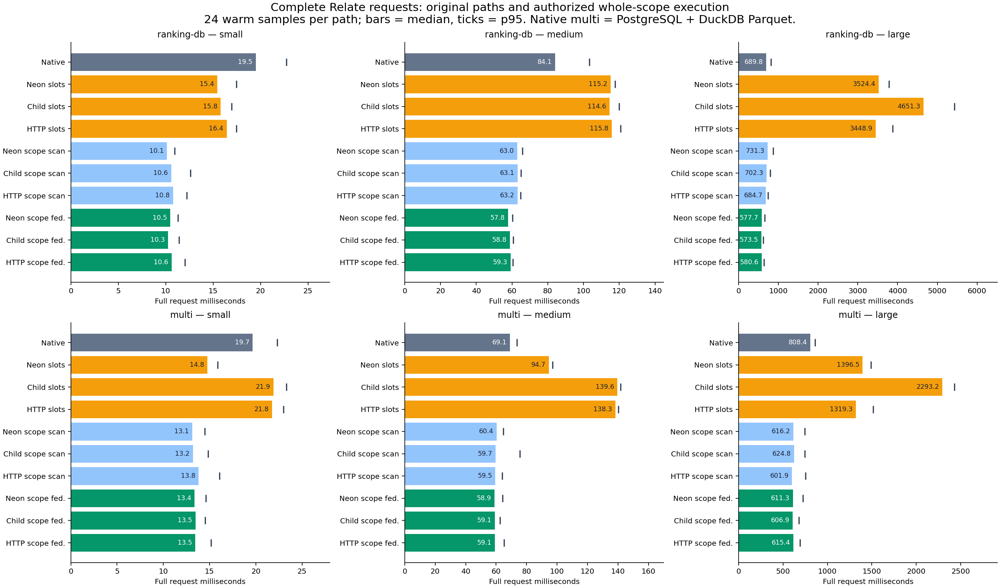
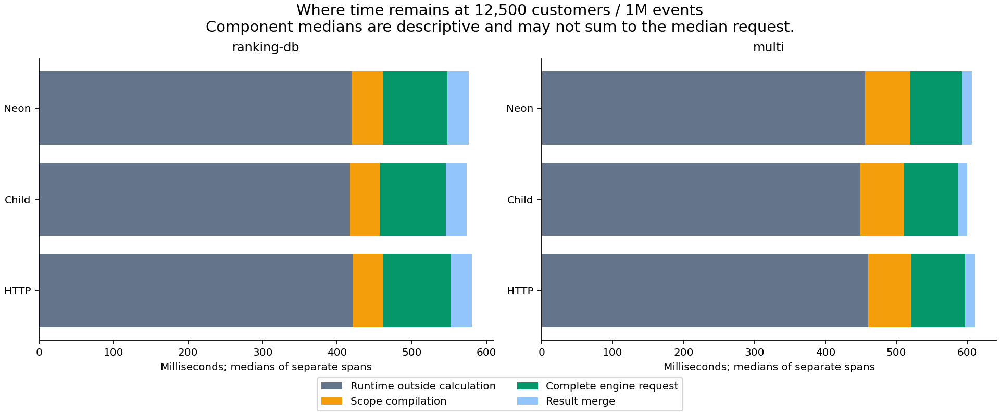
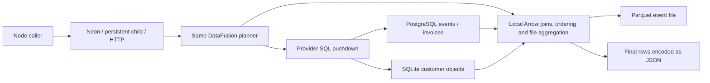
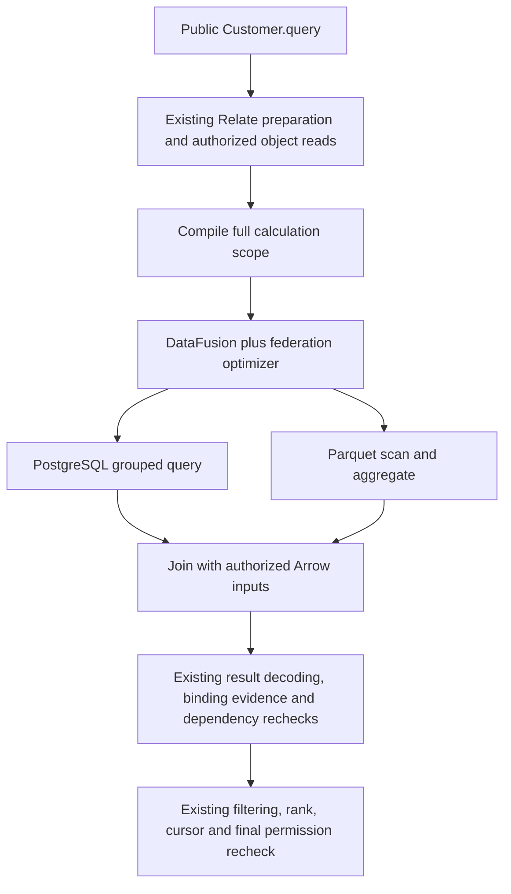
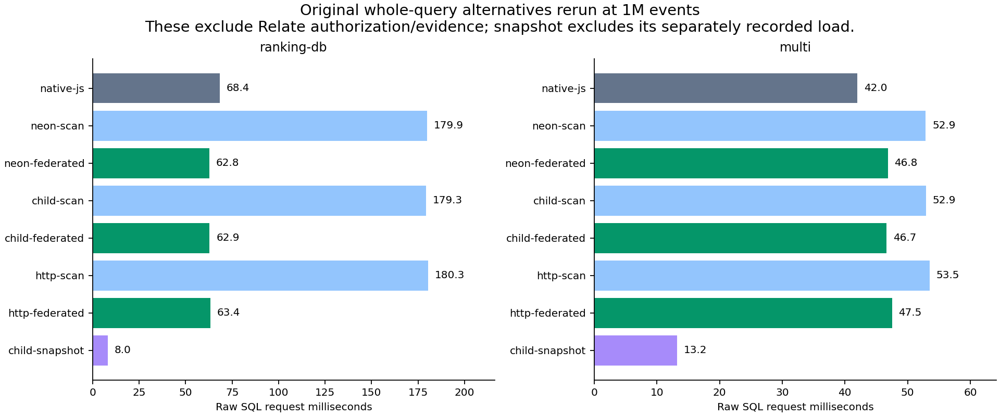

# DataFusion federation spike — 23 October 2026

Can DataFusion execute Relate calculations across databases and files, and where
should it plug into the runtime? This spike builds the same Rust engine behind
three Node boundaries, measures raw multi-source SQL, and runs the real public
`Customer.query()` through ten execution paths. No shipped API or runtime
default changes.

All federation numbers come from one matrix run after merging the indexed memory
store (#49); the runtime baseline in
[core engine work](#core-engine-work-before-datafusion) is a separate run of the
analytical harness on the same code. Earlier measurements were taken while the
memory store searched its whole population for every object lookup, which
dominated large public requests; they have been removed rather than kept as a
baseline.

## Vocabulary

| Term             | Meaning                                                                                                  | Example                                                |
| ---------------- | -------------------------------------------------------------------------------------------------------- | ------------------------------------------------------ |
| Federation       | One query joins data held in separate sources                                                            | SQLite customers + PostgreSQL invoices + Parquet       |
| Pushdown         | A source performs a filter or aggregate before sending rows back                                         | PostgreSQL runs `GROUP BY customer`                    |
| Scan mode        | Source filters/projections may run remotely; DataFusion aggregates locally                               | `query({ mode: 'scan', sql })`                         |
| Federated mode   | The federation optimizer may delegate whole SQL subplans to a source                                     | `query({ mode: 'federated', sql })`                    |
| Transport        | The Node/Rust boundary for the same engine                                                               | Neon addon, JSON-lines child, loopback HTTP            |
| Slot             | One authorized object's keys and calculation masks inside a Relate connector batch                       | `{ slot: 0, k0: '00009452', m0: true }`                |
| Slot scan        | Connector replacement: the runtime emits separate batches, each executed by DataFusion in scan mode      | ten batches of 1,000 slots                             |
| Authorized scope | Every customer the runtime allows, with typed correlation values and per-calculation validity masks      | `{ rowIndex: 0, values: ['00000001'], valid: [true] }` |
| Scope scan       | One query over the whole authorized scope, with local DataFusion aggregation                             | `relate-child-scope-scan`                              |
| Scope federation | The same single query with the federation optimizer able to push source subqueries                       | `relate-child-scope-federated`                         |
| Revalidation     | Re-read object access and dependencies before publishing calculated values                               | revoked customer is dropped from the page              |
| Snapshot         | A loaded copy of source rows; later source changes do not appear automatically                           | `query('snapshot')`, then `cached_events`              |
| Native reference | Existing PostgreSQL connector (plus a benchmark DuckDB Parquet reader for `multi`) with runtime batching | `relate-postgres`, `relate-native`                     |
| p95              | 95% of the recorded warm requests finish at or below this value                                          | 24 samples → 23rd-fastest                              |

## Findings and recommendation

**Whole-scope federation is now a real end-to-end win, and the old connector
replacement is clearly the wrong integration point.** At 12,500 customers / 1M
events (10,000 authorized):

| Query                                  | Native reference | Old slot scan (3 transports) | Scope federation (3 transports) | Paired ratio vs native |
| -------------------------------------- | ---------------: | ---------------------------: | ------------------------------: | ---------------------: |
| `ranking-db` (PostgreSQL events)       |           690 ms |               3,449–4,651 ms |                      574–581 ms |              0.84–0.86 |
| `multi` (Parquet events + PG invoices) |           808 ms |               1,319–2,293 ms |                      607–615 ms |              0.75–0.77 |

- **Integrate before batching.** Giving DataFusion the whole authorized scope
  removes the slot path's repeated full-table reads: it is 6–8× faster than slot
  scan for database ranking and 14–16% faster than the shipped PostgreSQL
  connector.
- **Pushdown matters for database sources.** For `ranking-db`, federation cuts
  the engine request from 196.5–201.2 ms (scope scan) to 86.5–90.5 ms. For
  `multi`, the Parquet aggregation stays local, so scope scan and scope
  federation are within noise (paired ratio 0.97–1.03); the gain over native
  comes from one combined engine query.
- **Relate's own runtime is now the bottleneck, not the calculation engine.**
  About 420 ms (72–73%) of a large scope-federated request is outside the
  engine; DataFusion saves about 110 ms over the shipped connector. With the
  PostgreSQL object store the same ranking takes 1,006 ms. Do the
  [core engine work](#core-engine-work-before-datafusion) first; DataFusion
  remains the plan for cross-source calculations.
- **Choose the transport for deployment, not speed.** Neon, child and HTTP stay
  within ~1.5% of each other on scope-federated public requests. A persistent
  child remains the practical next integration candidate once it has bounded
  parallel admission.
- **Keep native execution as baseline and option.** Native JS still wins the raw
  single-customer `selective` query (3.3 ms vs 16.6–17.3 ms) and the raw
  three-source query (42 ms vs 47 ms).
- **A snapshot is a separate architecture choice.** Its 8–13 ms reads move a 303
  ms load and staleness obligations elsewhere.

These are observations on one developer machine, not production guarantees.

## Full public-runtime comparison

Warm medians in milliseconds, 24 samples per cell. Small = 100 customers / 1,000
events; medium = 1,000 / 100,000; large = 12,500 / 1,000,000. Authorized
populations are 80, 800 and 10,000. `multi` has one invoice per five events.

| Query      | Size   | Native | Neon scope federation | Child scope federation | HTTP scope federation |
| ---------- | ------ | -----: | --------------------: | ---------------------: | --------------------: |
| ranking-db | small  |  19.51 |                 10.50 |                  10.27 |                 10.63 |
| ranking-db | medium |  84.07 |                 57.81 |                  58.83 |                 59.32 |
| ranking-db | large  | 689.78 |                577.75 |                 573.51 |                580.63 |
| multi      | small  |  19.67 |                 13.36 |                  13.48 |                 13.46 |
| multi      | medium |  69.15 |                 58.87 |                  59.13 |                 59.14 |
| multi      | large  | 808.44 |                611.25 |                 606.87 |                615.41 |

All ten paths at the large size:

| Path                   | Ranking median | Ranking p95 | Multi median | Multi p95 |
| ---------------------- | -------------: | ----------: | -----------: | --------: |
| Native reference       |         689.78 |      814.78 |       808.44 |    861.62 |
| neon: slot scan        |       3,524.44 |    3,784.22 |     1,396.46 |  1,488.07 |
| child: slot scan       |       4,651.34 |    5,429.93 |     2,293.18 |  2,429.87 |
| http: slot scan        |       3,448.89 |    3,873.59 |     1,319.28 |  1,514.23 |
| neon: scope scan       |         731.25 |      871.97 |       616.24 |    746.70 |
| child: scope scan      |         702.31 |      797.40 |       624.78 |    745.62 |
| http: scope scan       |         684.71 |      734.41 |       601.86 |    751.48 |
| neon: scope federated  |         577.75 |      653.19 |       611.25 |    725.17 |
| child: scope federated |         573.51 |      618.39 |       606.87 |    676.82 |
| http: scope federated  |         580.63 |      634.35 |       615.41 |    690.89 |

The child slot path is slowest because its serial worker queues the ten batch
requests; that is this implementation's admission policy, not a pipe limit.



## Engine benefit versus remaining runtime cost

| Query      | Boundary | Full request | Scope compiler | Engine request | Result merge | Runtime outside scope |
| ---------- | -------- | -----------: | -------------: | -------------: | -----------: | --------------------: |
| ranking-db | neon     |       577.75 |          41.04 |          86.51 |        28.79 |                420.14 |
| ranking-db | child    |       573.51 |          40.30 |          88.03 |        28.16 |                417.36 |
| ranking-db | http     |       580.63 |          40.23 |          90.48 |        28.30 |                421.59 |
| multi      | neon     |       611.25 |          63.54 |          72.89 |        14.15 |                456.24 |
| multi      | child    |       606.87 |          60.51 |          77.44 |        12.48 |                449.52 |
| multi      | http     |       615.41 |          60.62 |          76.20 |        13.68 |                460.25 |

Medians of separate spans; they need not sum to the median total. Engine
planning/collection/encoding are nested inside the engine request. Outside-scope
time includes candidate authorization, ordinary field reads, materialization,
revalidation, sorting and projection. [Full tables](tables.md) include every
span, paired within-block contrasts, p95, timer lag, setup, RSS and all raw SQL
workloads.



The median largest observed timer delay on large scope-federated requests is
about 214–215 ms (native: similar). Moving the engine off the JS thread does not
remove the remaining Node work. The timer probe only measures delayed ticks it
observes; it is not a complete event-loop profile.

## What was built

| Implementation   | Concrete boundary                                                    | What executes                                                                   |
| ---------------- | -------------------------------------------------------------------- | ------------------------------------------------------------------------------- |
| Neon addon       | `await addon.query(handle, json)`                                    | Same Rust engine inside Node; task/Promise runs work off the JS thread          |
| Persistent child | One JSON request per stdin line, one response per stdout line        | Same engine in an independently killable process; requests queued serially      |
| HTTP service     | `POST /query` on an ephemeral loopback port                          | Same executable with an HTTP entry point and concurrent request tasks           |
| Slot adapter     | Existing `AnalyticalConnector.plan/execute` contract                 | Runtime batches → DataFusion scan mode per batch                                |
| Scope executor   | Benchmark-only hook at the runtime's `computeFields` call            | One engine query over the whole authorized scope, before batching               |
| Native reference | Node PostgreSQL/SQLite drivers, DuckDB Parquet reader, JS merge/sort | Source-side aggregation on every request (raw); shipped connector (public path) |
| Arrow snapshot   | Explicit `query('snapshot')`, then `cached_*` tables                 | Local in-memory query after loading all sources                                 |

```js
const engine = await openTransport('child', fixture.config); // or 'neon', 'http'
const response = await engine.query({
  mode: 'federated',
  sql: querySql('multi'),
});
await engine.close();
```



The executor accepts trusted benchmark SQL and registers fixed fixture tables;
it is not a public SQL endpoint or a finished Relate connector.

## Why the slot adapter is slow

The pinned federation planner rejects the `VALUES` relation in generated slot
SQL, so the adapter explicitly uses scan mode, with no timed fallback. The
untimed [slot-plan capture](slot-plan.json.gz) (`diagnose.mjs`) records **ten
batches of 1,000 slots**; each batch reads every event with no pushed filter:

```sql
SELECT events.customer, events.type, events."at" FROM events;
```

The whole-scope executor replaces those ten requests with one query whose
authorized inputs are request-local Arrow tables, not `VALUES`:

```sql
SELECT a.row_index,
       CASE WHEN s.m0 THEN CAST(COALESCE(e.n, 0) AS VARCHAR) END AS login_count,
       CASE WHEN s.m1 THEN e.last_login END AS last_login
FROM authorized a
LEFT JOIN scope_0 s ON s.row_index = a.row_index
LEFT JOIN (
  SELECT customer, COUNT(*) AS n, MAX(at) AS last_login
  FROM events
  WHERE type = 'login'
    AND at >= TIMESTAMP '2026-10-01 00:00:00'
    AND at < TIMESTAMP '2026-11-01 00:00:00'
  GROUP BY customer
) e ON e.customer = s.k0
ORDER BY a.row_index;
```

With federation the grouped subquery runs in PostgreSQL and returns about 12,500
rows to join with 10,000 authorized inputs. With federation disabled the same
query reads about 542,200 matching events once and aggregates in DataFusion.
Exact generated SQL and physical plans are retained under `plans` in each
archive (`scenario: relate-ranking-db` or `relate-multi`).

For `multi`, event counts/latest-login come from Parquet and paid invoice totals
from PostgreSQL in one DataFusion request. Each many-side is grouped
independently before joining, so invoices cannot multiply events. The database
grouping is delegated; file grouping and the cross-source joins run in
DataFusion.



This does not move every part of `Customer.query()` into DataFusion. It returns
all computed candidates; the runtime revalidates them and chooses the final
page. Moving `LIMIT 25` ahead of those checks could omit a replacement customer
when a higher-ranked customer loses access during execution; the spike tests
that revocation case.

## Boundary exercised by the spike

The consumer still calls the existing API:

```ts
Customer.query({
  select: ['key', 'name'],
  where: { portfolio: 'north' },
  compute: { loginCount, lastLogin },
  orderBy: [{ field: 'loginCount', direction: 'desc' }],
  limit: 25,
});
```

After preparation and authorization, the benchmark executor sends one trusted
engine request:

```js
await engine.query({
  mode: 'federated',
  sql: generatedSql,
  candidateIds: ['customer-object-id'],
  scopes: [
    {
      keyCount: 1,
      maskCount: 2,
      rows: [{ rowIndex: 0, values: ['00000001'], valid: [true, true] }],
    },
  ],
});
```

`rowIndex` ties a result to the exact authorized object; a shared customer key
does not merge object identities. The two booleans say whether each calculation
is valid for that object. This is a benchmark shape, not an exported API or a
token an untrusted caller can construct. A product integration would replace the
loader hook with a typed runtime-owned executor contract.

## Original raw SQL alternatives

These include source reads and engine work but **exclude Relate authorization,
evidence, revalidation and object-store work**, and break ties by source key.
They are not interchangeable with public-request latencies. Large-size warm
medians, milliseconds:

| Query        | Native JS | Neon federation | Child federation | HTTP federation | Child scan | Child snapshot |
| ------------ | --------: | --------------: | ---------------: | --------------: | ---------: | -------------: |
| ranking-db   |     68.43 |           62.80 |            62.87 |           63.35 |     179.30 |           8.01 |
| ranking-file |     31.10 |           19.84 |            19.75 |           20.65 |      19.75 |          10.69 |
| multi        |     42.00 |           46.84 |            46.66 |           47.50 |      52.90 |          13.24 |
| selective    |      3.32 |           16.95 |            16.58 |           17.33 |      16.76 |           7.68 |
| bulk         |     73.29 |           76.20 |            78.14 |           79.58 |     195.25 |          23.89 |



Pushdown is the main raw-SQL lever: database ranking falls from 179 ms (scan) to
63 ms (federated), about 2.9×. Scan mode asks PostgreSQL for matching rows:

```sql
SELECT customer, "at" FROM events
WHERE type = 'login'
  AND "at" >= TIMESTAMP '2026-10-01 00:00:00'
  AND "at" < TIMESTAMP '2026-11-01 00:00:00';
```

Federated mode delegates the grouping:

```sql
SELECT customer, COUNT(*) AS n, MAX("at") AS last_login
FROM events
WHERE type = 'login'
  AND "at" >= TIMESTAMP '2026-10-01 00:00:00'
  AND "at" < TIMESTAMP '2026-11-01 00:00:00'
GROUP BY customer;
```

The native baseline is a query-specific application: grouped SQL in PostgreSQL,
DuckDB over Parquet, then a JavaScript join and sort. It has no general planner.
Native `control` returns a JS constant, so it is not an equivalent SQL baseline.

## Remaining runtime cost: CPU profile

A separately profiled warm child-federation request at the large size took **611
ms** (engine request 87 ms). It made **125 membership scans and 101 batched
loads covering 10,025 objects, with zero single-object loads** and zero
fetches/accepts. These are diagnostic values, not benchmark samples: profiling
adds overhead.

| Self time (named frames)                                       |   ms |
| -------------------------------------------------------------- | ---: |
| Profiler control (`node:inspector post`)                       | 95.8 |
| `structuredClone` (four frames)                                | 95.8 |
| `readObject` — `packages/runtime/src/resolution/source.ts:179` | 65.6 |
| Garbage collector                                              | 31.9 |
| `canonicalTimestamp`, `scalarCompare`, `canonicalJson`         | 29.4 |

The clones come from the memory store returning copies of each stored object
(`packages/runtime/src/memory.ts:81`, `:120`, `:148`) and from request snapshots
in `queries/query.ts:147` and `analytical-reads/prepare.ts`. The next runtime
leads are fewer defensive copies on read paths and cheaper per-object
`readObject` work for 10,000 candidates. The checks themselves must remain. See
the [retained summary](profile-summary.json) and the
[full Node profile](node.cpuprofile.gz) (decompress and open in DevTools; frame
lines refer to built JavaScript). The profile ran at `2ba046b`, which differs
from the measured commit only by counting `loadMany` in `profile.mjs`.

## Core engine work before DataFusion

DataFusion's gain on a single-source query (about 110 ms) is smaller than the
runtime work around it. These runtime changes come first; each removes repeated
work rather than speeding up an engine. Gains below are estimates from the
profile and call counts, not measurements.

Same large ranking through the analytical harness, both object stores, same
commit (`730e34a`), 24 warm samples each, [archives](runtime-baseline/):

| Object store |   Median |      p95 | Scans | Objects batch-loaded | `identify()` calls |
| ------------ | -------: | -------: | ----: | -------------------: | -----------------: |
| Memory       |   653 ms |   732 ms |   125 |               10,025 |             62,575 |
| PostgreSQL   | 1,006 ms | 1,042 ms |   125 |               10,025 |             62,575 |

What one full-scope ranking does today
(`packages/runtime/src/analytical-reads/read.ts`):

```text
1. Candidate collection: read + authorize all 10,000 objects   (125 scan pages of 100)
2. Compute: one engine query (or 10 connector batches)
3. Revalidate ALL 10,000: re-read + re-authorize each one     (101 loadMany calls)  read.ts:287
4. rankPage: sort, keep 25                                                         read.ts:301
5. Revalidate those 25 again                                                       read.ts:313
```

Every candidate is read and authorized twice to return 25 rows; each read runs
the full single-object path (`resolution/source.ts:179`).

| #   | Change                                                 | Where                                                        | Why                                                                                                                                                |
| --- | ------------------------------------------------------ | ------------------------------------------------------------ | -------------------------------------------------------------------------------------------------------------------------------------------------- |
| 1   | Revalidate in ranked order until the page is full      | `analytical-reads/read.ts:287–318`                           | ~26 re-reads instead of 10,025; merges steps 3 and 5. Largest expected win, and removes most store round trips on PostgreSQL                       |
| 2   | Verify each source account once per request            | `resolution/source.ts:95`, `observations/fetch.ts:36`        | 62,575 `identify()` calls (~6 per candidate), each with its own timer. Instant here; a network `identify()` would make one ranking 62k round trips |
| 3   | Prepare the read plan once per request, not per object | `resolution/source.ts:193–274`                               | Request validation, manifest/source lookups, policy, `select`/`visible` lists and `createAuthorization` are recomputed 20,000 times                |
| 4   | Stop defensive copies on read paths                    | `memory.ts:81`, `:120`, `:148`; `analytics/revalidate.ts:70` | `structuredClone` is the largest named cost in the profile (~96 ms, 14%); read-only snapshots avoid it                                             |
| 5   | Larger scan pages for full-scope ranking               | `analytical-reads/query.ts:66`                               | 125 sequential pages of 100; 1,000 per page (or streaming) means ~13 round trips on the PostgreSQL store, at higher per-page memory                |

Sketch for #1 (not agreed):

```ts
const queue = rankedByComputedPosition(computedRows); // no revalidation yet
const page = [];
while (page.length < limit + 1 && queue.size) {
  // +1 decides `exhausted`
  const row = await revalidate(queue.pop());
  if (!row) continue; // lost access: next one moves up
  if (fieldsChanged(row)) {
    reinsertIfStillMatches(queue, row);
    continue;
  }
  page.push(row);
}
```

Revalidation can only make a computed field unavailable or forbidden, never
change its value (`analytics/revalidate.ts`), so re-inserting changed rows
preserves today's answer, including the in-flight revocation case this spike
tests. The paging contract (`exhausted`, cursor) needs agreement before
implementation.

Recommended order: 1 and 2, then 5, then 3 and 4. Re-measure after each with
`bench:analytical` (both stores) and this federation matrix. Later: per-object
evidence hashing (`canonicalJson`, `canonicalTimestamp`, ~30 ms) and not
recomputing the whole scope for every next page.

## Integration ergonomics

| Concern                 | Neon                                                                  | Persistent child                                                    | HTTP service                                                                      |
| ----------------------- | --------------------------------------------------------------------- | ------------------------------------------------------------------- | --------------------------------------------------------------------------------- |
| Caller experience       | Async Promise, JS handle                                              | Async Promise, process framing                                      | Async fetch, independently hosted process                                         |
| Public-request speed    | Within ~1.5% of the others (scope federation)                         | Same; slowest for slot batches due to its serial queue              | Same; loopback only, WAN not measured                                             |
| Failure boundary        | Native crash can kill Node                                            | Child kill is isolated from Node                                    | Service kill is isolated from Node                                                |
| Parallel admission here | Node worker pool, four default slots                                  | One serial worker                                                   | Concurrent Tokio requests                                                         |
| Packaging               | Per-platform `.node` artifact plus Node loader                        | Per-platform executable                                             | Executable plus deployment/connection configuration                               |
| Shutdown here           | Release handle, GC; no production drain API                           | SIGTERM and await exit                                              | SIGTERM and await exit                                                            |
| Production gaps         | Prebuild matrix, cancellation, explicit drain, worker-pool contention | Supervision, request IDs, bounded queue, concurrent worker strategy | Authentication/TLS, quotas, routing, cancellation propagation, service operations |

| Run    | Neon startup ms | Child startup ms | HTTP startup ms |
| ------ | --------------: | ---------------: | --------------: |
| small  |           25.62 |            23.83 |           22.02 |
| medium |          215.79 |           279.29 |          130.92 |
| large  |           21.37 |            23.49 |           21.85 |

Startup includes schema discovery and pool creation. Each value is one
observation with uncontrolled OS caches, not a cold-start distribution; the
medium outlier is not explained by this run.

The release addon and executable are each about 140 MiB on macOS arm64. Rust
dependencies stay isolated from ordinary pnpm install/build. DataFusion 54.1 /
federation 0.5.5 / providers 0.12 / Neon 1.1.1 are pinned; DataFusion 55.2
requires a newer Rust compiler than 1.92 and is not measured.

## Burst concurrency (raw SQL)

Five waves of four arrivals per transport/mode, 20 requests each, at the large
size. Short bursts including validation between waves; fixed path order after
the sequential matrix. They do not exercise the public runtime.

| Path            | Requests/sec | Request median ms | Request p95 ms |
| --------------- | -----------: | ----------------: | -------------: |
| neon-scan       |        23.91 |            155.77 |         177.88 |
| neon-federated  |        40.51 |             80.47 |         128.06 |
| child-scan      |        18.03 |            157.04 |         217.76 |
| child-federated |        20.06 |            112.87 |         183.66 |
| http-scan       |        24.83 |            139.68 |         162.38 |
| http-federated  |        40.84 |             78.80 |         155.94 |

The child's serial queue is this implementation's policy; a production child
needs multiplexing or a pool before comparing equal admission.

## Snapshot cost and freshness

| Run    | Load all four tables ms | Ranking read ms | Three-source read ms |
| ------ | ----------------------: | --------------: | -------------------: |
| small  |                    4.21 |            2.64 |                 3.54 |
| medium |                   34.71 |            3.42 |                 4.73 |
| large  |                  303.26 |            8.01 |                13.24 |

The snapshot loads customers, both event copies and invoices into Arrow once. It
does not cache answers, excludes refresh/invalidation, and becomes stale as soon
as a source changes; this spike has no concurrent source mutation.

## Prototype limits

- String correlation keys; COUNT/MAX/SUM and scalar fallbacks; source-column
  predicates. No per-object predicate operands or aggregate arithmetic.
  Unsupported expressions fail; there is no silent fallback.
- Activity capture disabled. No production queue/admission, canonical error
  mapping, remote cancellation, cross-source snapshot consistency or independent
  per-source observation timestamps.
- PostgreSQL may aggregate keys outside the authorized population internally;
  the trusted executor joins back to the authorized scope before returning. Not
  source-level row security.
- The native Parquet adapter is a narrow benchmark reader, not the shipped
  DuckDB connector. The Rust PostgreSQL provider uses `hostaddr` to avoid a
  failing DNS preflight on loopback.
- No WAN, object storage, concurrent writes, distributed snapshots, spill
  pressure or cross-platform addon matrix. RSS is after-request, over unequal
  process populations; do not rank memory efficiency.

## Measurement controls

- Fixed deterministic input; every complete output is checked against an
  independent SQLite oracle after the request clock stops. Raw SQL ties use
  source-key order, public requests use object-ID order; compare result hashes
  within those groups only.
- Path order rotates and reverses each cycle. One first-of-scenario and two
  warmups per path are recorded separately and excluded from tables.
- Public paths share one adopted memory store, object IDs and frozen fixture
  clock. Every timed public request asserts **zero source refreshes**.
- 24 warm repeats permit descriptive nearest-rank p95, not statistical
  significance. No CI timing gate.

## Validation and provenance

- **5,508 sequential samples** (4,896 warm) across three sizes plus **360 burst
  requests**. Zero failures or result mismatches; every public sample reports
  zero source refreshes.
- Both integration suites pass on Neon, child and HTTP: native/slot/scope
  parity, both optimizer modes, denied object/dataset access before engine work,
  duplicate keys with distinct masks, request-table isolation under concurrent
  arrivals, malformed inputs/results, empty populations, unsupported per-object
  predicates, retained binding/dependency evidence, and a permission change
  during execution.
- Repository-wide `pnpm check` passed at the current branch head; see the
  [validation log](validation.log).
- Measured source `85137b70577876d7be488bea379cbdc8a6c808d2`, clean at the start
  of all three runs. The branch head `730e34a` adds a later `main` merge that
  changes only documentation (`README.md`, `specs/`); no runtime, connector or
  benchmark code differs. The runtime baseline archives were measured at
  `730e34a`. Source/input/result hashes, timing samples and physical plans are
  retained in [small](small.json.gz), [medium](medium.json.gz) and
  [large](large.json.gz). [Artifact hashes](artifacts.json) identify the shared
  executable and addon (unchanged by the merge).
- Apple M2 Max, 12 logical CPUs, 64 GiB RAM, Darwin 25.6.0 arm64; Node 26.9.0,
  Rust 1.92.0, PostgreSQL 18.6, SQLite 3.53.4. Four engine threads/partitions,
  four-connection PostgreSQL pool; child requests serial.

Reproduce with the [harness README](../README.md); `uv run analyze.py` rebuilds
[tables](tables.md), [summary](summary.json) and charts from the archives.

## Next concrete work

First, the [core engine work](#core-engine-work-before-datafusion). Then, for
DataFusion:

1. Define a typed runtime-owned executor contract at the pre-batching point,
   carrying candidate keys, masks, binding revisions and evidence requirements.
   Keep final revalidation until equivalent behavior is demonstrated.
2. Source capability rules for pushdown selection, verified from physical plans
   and transferred-row counters rather than an engine label.
3. Bounded parallel child admission, then compare equal concurrency policies
   before choosing addon, embedded process or shared service.
4. Policy changes, timestamp/decimal edge cases, backend cancellation, network
   delay, source failure and memory/spill limits.
