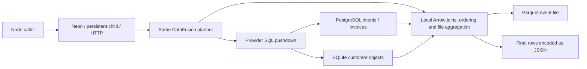
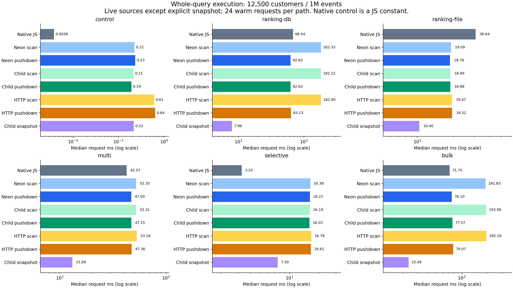
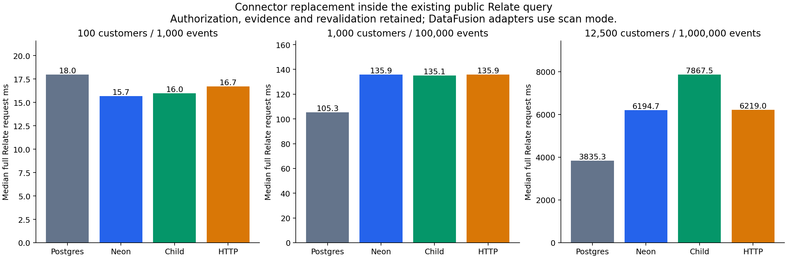
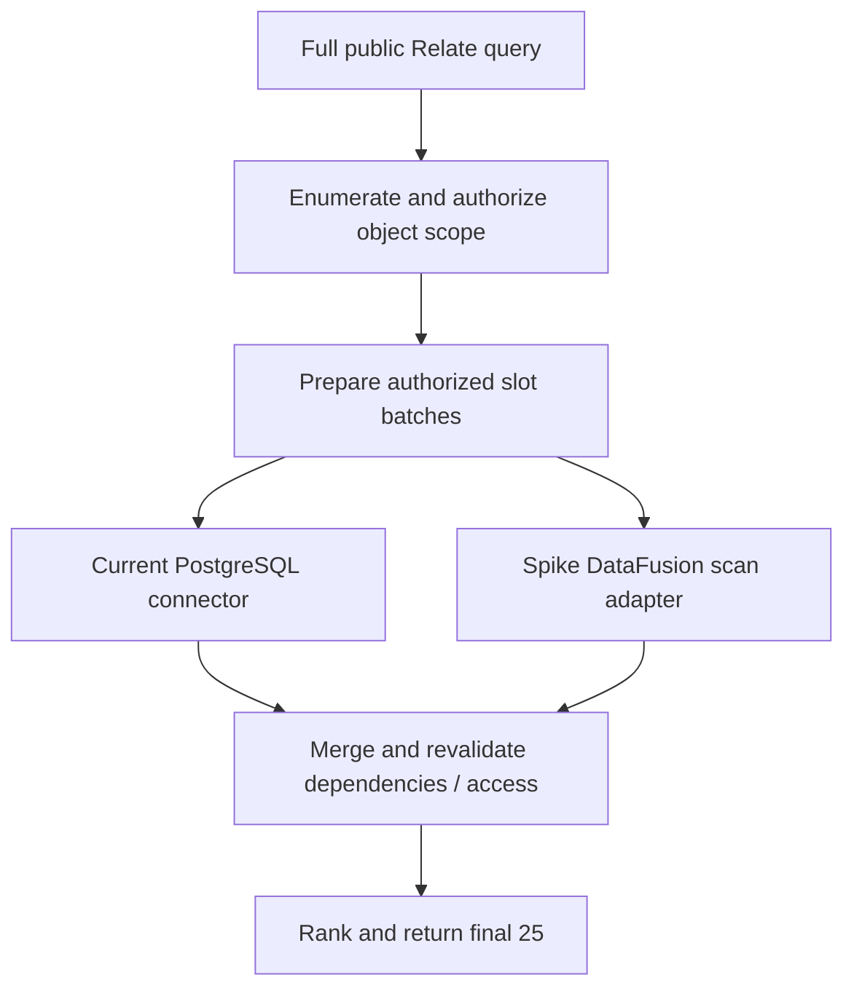

# DataFusion federation spike — 22 October 2026

DataFusion works as a federation engine across SQLite, PostgreSQL and Parquet.
The strongest measured benefit comes from deciding **where aggregation
happens**, not from choosing Neon instead of a local process. Replacing Relate's
current connector with DataFusion scan execution does not deliver an end-to-end
speedup.

## Vocabulary

| Term         | Plain meaning                                                                           |
| ------------ | --------------------------------------------------------------------------------------- |
| Federation   | One query joins data held in separate sources                                           |
| Pushdown     | A source performs a filter or aggregate before sending rows back                        |
| Scan mode    | Source filters/projections may run remotely, but DataFusion performs aggregates locally |
| Arrow        | Typed columns held in memory as batches rather than individual JavaScript objects       |
| Snapshot     | A loaded copy of source rows; later source changes do not appear automatically          |
| Transport    | The Node/Rust boundary: addon, pipe or HTTP                                             |
| Slot         | One authorized object's keys and calculation masks in a Relate batch                    |
| Revalidation | Relate checks that access and dependencies still permit publishing results              |
| p95          | 95% of the recorded warm requests finish at or below this value                         |

## Read this first

- **Keep the shared Rust engine and prototype an out-of-process integration.**
  For an embedded Node deployment, start with a persistent child and add bounded
  parallel admission or a small pool. Use the standalone service when shared
  deployment and independent scaling are requirements. Those are proposed next
  steps, not an adopted product architecture.
- **Keep source pushdown as an explicit planning option.** At 1M events it cuts
  the database-ranking path from about 182 ms to 63 ms, approximately 2.9×. Neon
  and the child have the same rounded median in that comparison.
- **Do not replace the current PostgreSQL connector on these results.** The
  narrow adapter preserves Relate runtime work but cannot federate its VALUES
  slot input with the pinned upstream planner; scan mode repeats expensive
  reads.
- **Treat specialized native execution as a serious alternative.** It wins at
  smaller sizes and on the three-source workload. DataFusion wins the large
  Parquet ranking workload and has a modest observed advantage on large database
  ranking. There is no universal winner.
- **A snapshot is a separate architecture choice.** Its faster queries move
  source reads into an explicit load step and introduce staleness/refresh
  obligations.

For terms and executable commands, see the [harness README](../README.md).
[Research notes](../RESEARCH.md) link the inspected Cube, DataFusion, Spice,
MetricFlow and Neon sources. [Full tables](tables.md) contain every scenario,
paired within-block contrast, burst result and archive hash.

## What was actually built

| Implementation                  | Concrete boundary                                                    | What executes                                                                                                                    |
| ------------------------------- | -------------------------------------------------------------------- | -------------------------------------------------------------------------------------------------------------------------------- |
| Neon addon                      | `await addon.query(handle, json)`                                    | Same Rust engine inside Node; task/Promise runs work off the JS thread                                                           |
| Persistent child                | One JSON request per stdin line, one response per stdout line        | Same engine in an independently killable process; requests queued serially                                                       |
| Standalone service              | `POST /query` on an ephemeral loopback port                          | Same executable with HTTP entry point, concurrent request tasks                                                                  |
| Relate adapter                  | Existing `AnalyticalConnector.plan/execute` contract                 | Public `Customer.query()` retains authorization, evidence, batching, revalidation and ranking; only analytical execution changes |
| Native reference implementation | Node PostgreSQL/SQLite drivers, DuckDB Parquet reader, JS merge/sort | Source-side aggregation on every request; no Relate evidence/revalidation                                                        |
| Arrow snapshot                  | Explicit `query('snapshot')`, then `cached_*` tables                 | Local in-memory query after loading all sources                                                                                  |

All adapters are kept in this PR. No shipped package API or production query
behavior changes. The executor accepts trusted benchmark SQL and registers fixed
fixture tables; it is not a general public SQL endpoint or a finished Relate
connector. The service is independently launchable but measured only on
loopback.

```js
const engine = await openTransport('child', fixture.config);
const response = await engine.query({
  mode: 'federated',
  sql: querySql('multi'),
});
await engine.close();
```



## Large workload: whole-query latency

12,500 customers, of which 10,000 are in the allowed portfolio; 1M events;
200,000 invoices. All paths read live sources on each call except the explicit
snapshot. Table values are warm medians in milliseconds; each has 24 samples.

| Query        | Native JS | Neon pushdown | Child pushdown | HTTP pushdown | Child scan | Child snapshot |
| ------------ | --------- | ------------- | -------------- | ------------- | ---------- | -------------- |
| ranking-db   | 68.04     | 62.62         | 62.62          | 63.23         | 182.22     | 7.96           |
| ranking-file | 30.64     | 18.76         | 18.88          | 19.52         | 18.89      | 10.40          |
| multi        | 42.57     | 47.00         | 47.15          | 47.36         | 52.31      | 13.09          |
| selective    | 3.25      | 16.22         | 16.03          | 16.61         | 16.19      | 7.59           |
| bulk         | 71.75     | 76.10         | 77.57          | 79.07         | 193.98     | 23.49          |



DataFusion keeps grouped intermediate rows in Arrow until the final result; the
native baseline converts those grouped rows into JavaScript before merging. That
is part of this whole-query comparison and may contribute to its results; we
have not isolated its causal cost.

The native baseline is a working, query-specific application implementation. It
pushes grouped SQL to PostgreSQL, uses DuckDB to group the Parquet file, then
joins and ranks in JavaScript. It does not include a general relational planner.
Native control returns a JS constant, so its timing is not an equivalent SQL
baseline.

## Why pushdown helps

The plan captures show different work at the PostgreSQL boundary. In scan mode,
DataFusion asks for matching rows and performs aggregation locally:

```sql
SELECT customer, "at" FROM events
WHERE type = 'login'
  AND "at" >= TIMESTAMP '2026-10-01 00:00:00'
  AND "at" < TIMESTAMP '2026-11-01 00:00:00';
```

Federated mode delegates the group operation:

```sql
SELECT customer, COUNT(*) AS n, MAX("at") AS last_login
FROM events
WHERE type = 'login'
  AND "at" >= TIMESTAMP '2026-10-01 00:00:00'
  AND "at" < TIMESTAMP '2026-11-01 00:00:00'
GROUP BY customer;
```

These readable excerpts omit generated aliases; the exact SQL and physical plan
are retained under `plans` in every raw result archive. The federated plan
returns roughly 12,500 aggregate rows from PostgreSQL. The SQLite customer
filter, local cross-source join and final top-25 ranking still execute. An added
optimizer rule does not eliminate cross-source data transfer.

The three-source query first aggregates events and invoices independently, then
joins those results to customers. That preserves the intended counts and sums
without multiplying each event by each invoice:

```sql
WITH e AS (
  SELECT customer, COUNT(*) n FROM file_events
  WHERE type = 'login' AND "at" >= '2026-10-01T00:00:00.000Z'
    AND "at" < '2026-11-01T00:00:00.000Z'
  GROUP BY customer
), i AS (
  SELECT customer, SUM(amount) paid FROM invoices
  WHERE paid = true GROUP BY customer
)
SELECT c.key, e.n, i.paid
FROM customers c
LEFT JOIN e ON c.key = e.customer
LEFT JOIN i ON c.key = i.customer
WHERE c.portfolio = 'north';
```

The actual benchmark also returns names/latest-login, coalesces empty
aggregates, orders and limits. That final work is included in timings.
PostgreSQL invoice aggregation can be pushed down; Parquet aggregation remains
local. This explains why enabling federation helps less here than on the
database-events workload.

## Does this improve Relate today?

| Customers / events | PostgreSQL | Neon scan | Child scan | HTTP scan |
| ------------------ | ---------- | --------- | ---------- | --------- |
| 100 / 1,000        | 18.00      | 15.66     | 15.99      | 16.72     |
| 1,000 / 100,000    | 105.30     | 135.92    | 135.13     | 135.93    |
| 12,500 / 1,000,000 | 3835.31    | 6194.71   | 7867.50    | 6219.02   |



The large-run p95 values were **5,008 ms** for PostgreSQL, **10,983 ms** for
Neon, **12,957 ms** for the child, and **13,647 ms** for HTTP. Those wide tails
matter: these developer-machine observations do not establish predictable
production latency or a statistically general transport ranking.

These are the real public Node-host query and the same benchmark model used by
the existing analytical suite. Both calculations are requested:

```ts
Customer.query({
  select: ['key', 'name'],
  where: { portfolio: 'north' },
  compute: { loginCount, lastLogin },
  orderBy: [{ field: 'loginCount', direction: 'desc' }],
  limit: 25,
});
```

The population, seed, time window and authorization policy reuse the existing
harness. This fresh run disables activity capture and uses cached memory
storage, so the
[older overhead report](../../analytical-properties/measurements/overhead-2026-10-22/README.md)
is historical context rather than the denominator for a speedup claim. That
report already identified candidate collection and revalidation as large costs.

The whole-query numbers omit those runtime responsibilities. Comparing a ~63 ms
federated SQL request to a multi-second Relate request is an **architecture
gap**, not a measured secure replacement or an engine-only speedup.



The pinned federation planner rejects `VALUES` in the generated slot relation.
The adapter therefore **explicitly uses scan mode**, with no timed fallback.
This is a real integration limitation, recorded in the development-failure
archive. The untimed [slot-plan capture](slot-plan.json.gz), reproduced with
`diagnose.mjs`, records **ten batches of 1,000 slots**. Its first batch reads
all 1M source events, with no pushed filter:

```sql
SELECT events.customer, events.type, events."at" FROM events;
```

The ten batch requests repeat that query shape with different authorized keys.
The exact first-batch physical plan and all generated slot SQL are retained.
This explains a concrete source of repeated work in the connector replacement.
An optimizer-aware authorized relation, rather than the current opaque batch
shape alone, is the promising next spike.

## Ergonomics and deployment

| Concern                 | Neon                                                                  | Persistent child                                                    | HTTP service                                                                      |
| ----------------------- | --------------------------------------------------------------------- | ------------------------------------------------------------------- | --------------------------------------------------------------------------------- |
| Caller experience       | Async Promise, JS handle                                              | Async Promise, process framing                                      | Async fetch, independently hosted process                                         |
| Single-request speed    | Similar to child for meaningful queries                               | Similar to Neon in pushdown workloads                               | Small observed local HTTP cost; WAN not measured                                  |
| Failure boundary        | Native crash can kill Node                                            | Child kill is isolated from Node                                    | Service kill is isolated from Node                                                |
| Parallel admission here | Node worker pool, four default slots                                  | One serial worker                                                   | Concurrent Tokio requests                                                         |
| Packaging               | Per-platform `.node` artifact plus Node loader                        | Per-platform executable                                             | Executable plus deployment/connection configuration                               |
| Shutdown here           | Release handle, GC; no production drain API                           | SIGTERM and await exit                                              | SIGTERM and await exit                                                            |
| Production gaps         | Prebuild matrix, cancellation, explicit drain, worker-pool contention | Supervision, request IDs, bounded queue, concurrent worker strategy | Authentication/TLS, quotas, routing, cancellation propagation, service operations |

| Run    | Neon startup ms | Child startup ms | HTTP startup ms |
| ------ | --------------- | ---------------- | --------------- |
| small  | 19.77           | 22.75            | 22.43           |
| medium | 24.21           | 26.46            | 24.60           |
| large  | 22.57           | 25.51            | 24.21           |

Startup includes schema discovery and pool creation. Each value is one observed
startup with uncontrolled OS caches, not a cold-start distribution. The addon
observation includes first module loading. Source fixture construction and
Relate adoption are separate raw fields.

The release addon and executable are each approximately 140 MiB on this macOS
arm64 build. The last engine edit rebuilt/linked in roughly 28 seconds with
existing dependency artifacts. No clean-cache successful build timing was
collected. Rust dependencies remain isolated from ordinary pnpm install/build.

Pinned DataFusion 54.1 / federation 0.5.5 / providers 0.12 / Neon 1.1.1 are a
working combination on Rust 1.92 and Node 26.9. DataFusion 55.2 required a newer
Rust compiler; the experiment does not claim results for it.

## Burst concurrency and responsiveness

| Path            | Requests/sec | Request median ms | Request p95 ms |
| --------------- | ------------ | ----------------- | -------------- |
| neon-scan       | 14.00        | 255.72            | 296.65         |
| neon-federated  | 19.24        | 191.73            | 229.29         |
| child-scan      | 7.90         | 305.24            | 523.54         |
| child-federated | 10.53        | 250.12            | 407.94         |
| http-scan       | 12.62        | 281.30            | 328.53         |
| http-federated  | 26.64        | 144.66            | 155.17         |

Five waves of four arrivals per transport/mode, 20 requests total. These are
short bursts including validation between waves, not a sustained capacity test.
They run in fixed path order after the sequential matrix; their relative
throughput is not an order-balanced comparison. The child's serial queue is part
of this implementation, not an inherent pipe limit. A production child design
needs multiplexing or a pool before comparing equal admission policies.
Likewise, Neon's shared Node worker pool deserves contention tests with other
native work.

Timer-delay observations are retained per sample, but a short request can finish
without a timer tick; null does not mean no blocking. The native baseline
performs SQLite reads and JS merges on the event loop. Neon uses off-thread
tasks; JSON serialization/decoding still takes place in Node.

## Snapshot cost and freshness

| Run    | Load all four tables ms | Ranking read ms | Three-source read ms |
| ------ | ----------------------- | --------------- | -------------------- |
| small  | 3.77                    | 2.28            | 3.26                 |
| medium | 34.64                   | 3.19            | 4.51                 |
| large  | 309.63                  | 7.96            | 13.09                |

The snapshot loads customers, both copies of events (PostgreSQL and Parquet),
and invoices into Arrow tables once. This intentionally over-copies the sources
needed by any single workload. It does not cache final query answers. Query
timings exclude load time and do not include refresh/invalidation. Values become
stale as soon as the source changes; this spike has no concurrent source
mutation.

RSS fields are after-request process observations, not peaks. Node includes the
fixture, oracle, native driver and addon; the child includes snapshot tables;
HTTP does not. PostgreSQL server memory and filesystem caches are excluded.
These populations cannot establish a fair memory-efficiency winner.

## Correctness, failures and reproducibility

- Environment: Apple M2 Max, 64 GiB RAM, macOS arm64, Node 26.9.0, Rust 1.92.0,
  PostgreSQL 18.6, SQLite 3.53.4. Four DataFusion partitions and four Tokio
  workers; local PostgreSQL pools capped at four connections per engine.
- Source frozen at `40e31b7`; all three retained performance runs began from a
  clean worktree. Raw metadata includes full commit, source hashes, binary hash,
  input hash, versions, hardware and timestamps.
- Independent SQLite SQL validates every complete output after the request
  clock, including bulk rows. Public paths share adopted object IDs and use
  Relate's object-ID tiebreak; whole-query paths use source-key tiebreak. Random
  adopted IDs can change which tied rows appear across fresh runs.
- Three sizes × 1,404 first/warmup/warm samples = 4,212 sequential observations;
  3,744 are warm measurements. Additional burst experiments validate 360
  requests. All completed with zero failures or result mismatches.
- Tests cover all three transports, both execution modes, native baseline, empty
  results, null amounts, denied portfolios, tied ranks, time boundaries,
  snapshots, malformed query recovery, explicit deadlines, four simultaneous
  requests, large integers represented as strings, process kill/restart and all
  public adapters. Deadline response does not prove remote statement
  cancellation.
- The oracle caught a real timezone-decoding problem: Arrow JSON omitted a zone
  and Node initially interpreted UTC data in local time across a DST boundary.
  The fixture is explicitly UTC and decoding now preserves that contract.
- Other retained failures: mixed DataFusion minor versions, PostgreSQL provider
  DNS preflight, provider discovery/returned-batch schema mismatch during
  snapshot construction, unsupported ordinary-property ordering in public
  queries, unsupported `VALUES` federation, and DuckDB's reserved `at`
  identifier.
- The provider DNS preflight failed even on loopback. The local-only spike uses
  PostgreSQL `hostaddr` and still establishes/verifies the actual connection.
  This is a narrow environment workaround, not general connection handling.
- Validation: benchmark integration suite; release Rust build; Rust formatting;
  focused ESLint/Prettier; package/runtime boundary checks; development policy.
  Final CI status is recorded in the PR. No full repository suite result is
  implied by the focused benchmark checks.

Sources are immutable during runs, PostgreSQL is local, and Parquet is on local
storage. No WAN, object-store access, concurrent writes, distributed snapshots,
spill pressure, production authorization equivalence, or cross-platform addon
matrix is established. JSON limits generic type fidelity; the adapter only
supports this workload's types and COUNT/MAX. A production service must receive
authorized plans and enforce bounded execution, not expose this trusted raw-SQL
runner.

## Next concrete work

1. Define an authorized object-relation contract that can carry candidate keys,
   readable fields, binding revisions and evidence requirements into one plan.
   Keep final runtime revalidation until equivalent behavior is demonstrated.
2. Implement/verify source capability rules and source-side aggregation
   selection. Preserve the native PostgreSQL path when it already performs best.
   Use physical plans and actual transferred-row/byte counters, rather than an
   engine label.
3. Add bounded parallel child admission and compare equal concurrency policies
   before choosing between addon, embedded process and shared service
   deployment.
4. Add Arrow IPC for large intermediate results only if profiles justify it;
   retain JSON for small final responses when its cost is immaterial.
5. Test policy changes, revocation, timestamp/decimal edge cases, cancellations
   that stop backend work, network delay, source failure and memory/spill
   limits.

The spike supports further work on an optimizer-visible federated query path. It
does not support replacing today's connector solely to make Relate faster.
