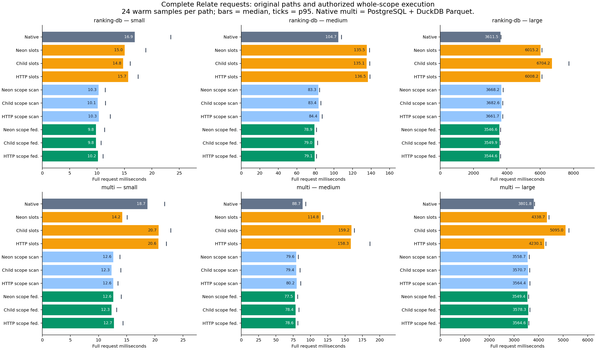
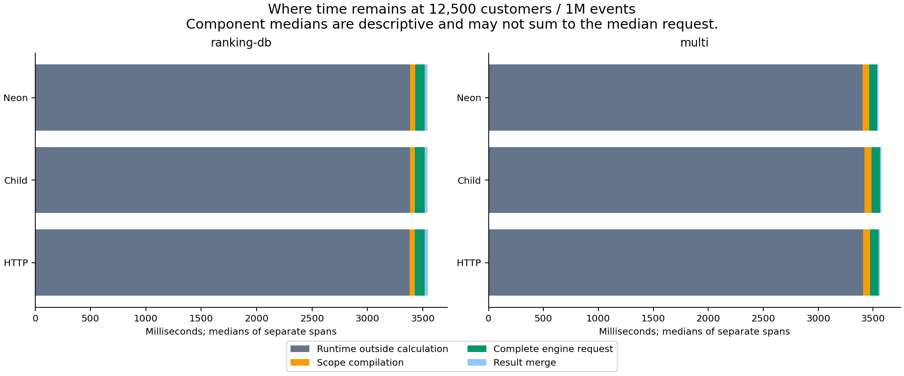
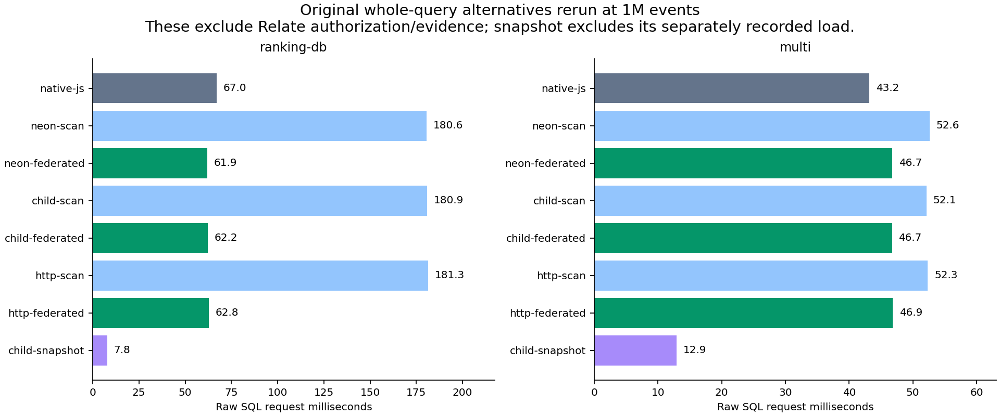
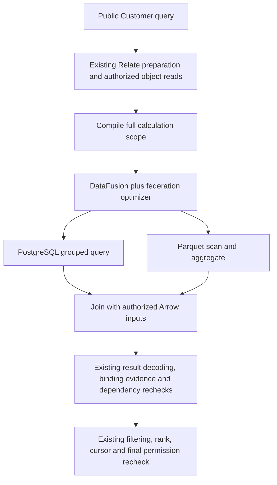

# Authorized whole-scope federation follow-up

This follow-up tests the integration point discussed in PR #46: let DataFusion
see all authorized calculation inputs before Relate partitions them into
connector statements. It retains the original implementations and reruns the
complete comparison. No shipped API or runtime default changes.

## Vocabulary

| Term             | Meaning                                                                                                    |
| ---------------- | ---------------------------------------------------------------------------------------------------------- |
| Authorized scope | Every customer allowed by the runtime, with typed correlation values and per-calculation validity masks    |
| Scope compiler   | Turns the already-authorized calculation definitions into a single relational query                        |
| Scope scan       | The new single-query shape with source filters/projections but local DataFusion aggregation                |
| Scope federation | The same shape with the federation optimizer able to delegate source subqueries                            |
| Slot scan        | The earlier connector replacement: the runtime emits separate batches, executed by DataFusion in scan mode |
| Revalidation     | Re-read object access and dependencies before publishing calculated values                                 |
| Native multi     | Existing PostgreSQL connector plus a benchmark-owned DuckDB reader over the real Parquet file              |

## Findings and recommendation

**The pre-batching federation integration works, but it is not the main fix for
the large end-to-end latency in this fixture.** It replaces repeated slot scans
with one authorized calculation, and DataFusion delegates supported source
aggregation. At 1M events, native PostgreSQL ranking is 3.61 s and scope
federation is 3.54–3.55 s: only about 2% lower median latency. The mixed-source
native path is 3.80 s versus 3.55–3.58 s, about 6–7% lower.

- Keep the **whole-scope integration point** for further federation work. The
  earlier connector-only scan path takes 6.01–6.70 s for large database ranking;
  the new path removes that regression.
- Keep native execution as a baseline and an option. The existing PostgreSQL
  connector already aggregates at the source; federation does not create an
  order-of-magnitude gain over that path.
- Prioritize the remaining object-store/runtime work if the immediate goal is
  faster large public queries. Roughly 95–96% of the scope-federated request
  remains outside scope compilation, engine execution and result merge.
- Choose the Node boundary primarily for deployment and lifecycle needs. These
  results do not establish a meaningful end-to-end winner among Neon, child and
  loopback HTTP. A persistent child remains a practical next integration
  candidate, with bounded admission/concurrency added before production use.

At smaller populations, reducing execution overhead helps more: database ranking
falls from 16.90 to 9.79–10.18 ms at the small size, and from 104.70 to
78.88–79.14 ms at the medium size. The complete scale comparison follows. These
are observations on one machine, not production guarantees.

## Full public-runtime comparison

Warm medians in milliseconds. Each cell has 24 samples. Small = 100 customers /
1,000 events; medium = 1,000 / 100,000; large = 12,500 / 1,000,000. The
authorized populations are 80, 800 and 10,000. `multi` additionally has one
invoice per five events.

| Query      | Size   |  Native | Neon scope federation | Child scope federation | HTTP scope federation |
| ---------- | ------ | ------: | --------------------: | ---------------------: | --------------------: |
| ranking-db | small  |   16.90 |                  9.79 |                   9.79 |                 10.18 |
| ranking-db | medium |  104.70 |                 78.88 |                  78.96 |                 79.14 |
| ranking-db | large  | 3611.45 |               3546.65 |                3549.85 |               3544.62 |
| multi      | small  |   18.67 |                 12.63 |                  12.30 |                 12.74 |
| multi      | medium |   88.68 |                 77.53 |                  78.42 |                 78.57 |
| multi      | large  | 3801.80 |               3549.43 |                3578.32 |               3564.62 |

All ten implementations at the large size:

| Path                   | Ranking median | Ranking p95 | Multi median | Multi p95 |
| ---------------------- | -------------: | ----------: | -----------: | --------: |
| Native reference       |        3611.45 |     3646.59 |      3801.80 |   3834.36 |
| neon: old slot scan    |        6015.24 |     6095.69 |      4338.66 |   4418.11 |
| child: old slot scan   |        6704.18 |     7716.68 |      5095.03 |   5231.19 |
| http: old slot scan    |        6008.18 |     6098.10 |      4230.10 |   4292.96 |
| neon: scope scan       |        3668.18 |     3767.19 |      3558.71 |   3620.55 |
| child: scope scan      |        3682.59 |     3750.77 |      3570.68 |   3632.06 |
| http: scope scan       |        3661.75 |     3749.02 |      3564.37 |   3649.03 |
| neon: scope federated  |        3546.65 |     3610.38 |      3549.43 |   3591.12 |
| child: scope federated |        3549.85 |     3589.56 |      3578.32 |   3642.72 |
| http: scope federated  |        3544.62 |     3616.47 |      3564.62 |   3597.48 |



## Engine benefit versus remaining runtime cost

For large database ranking, changing scope scan to scope federation reduces the
engine request from 194–199 ms to 84–90 ms, roughly 2.2–2.3×. The full public
request falls only from 3.66–3.68 s to 3.54–3.55 s because most time is
elsewhere. Scope compilation and merge also remain in Node.

| Query      | Boundary | Full request | Scope compiler | Engine request | Result merge | Runtime outside scope |
| ---------- | -------- | -----------: | -------------: | -------------: | -----------: | --------------------: |
| ranking-db | neon     |      3546.65 |          44.98 |          84.26 |        27.61 |               3386.95 |
| ranking-db | child    |      3549.85 |          43.77 |          87.73 |        27.81 |               3383.67 |
| ranking-db | http     |      3544.62 |          44.86 |          90.12 |        28.17 |               3382.16 |
| multi      | neon     |      3549.43 |          63.01 |          69.69 |        12.50 |               3403.14 |
| multi      | child    |      3578.32 |          63.65 |          74.74 |        12.77 |               3423.02 |
| multi      | http     |      3564.62 |          64.69 |          74.63 |        13.15 |               3408.61 |

Component medians do not necessarily sum to the median total. Engine
planning/collection/encoding are nested inside engine request time and are not
added again. [Full tables](tables.md) include those spans, paired within-block
contrasts, p95, timer lag, setup, RSS observations and all raw SQL workloads.



The median largest observed timer delay is about 2.74–2.77 s on large
scope-federated public requests, similar to the native paths. Moving the engine
off the JS thread does not remove the remaining Node work. This timer probe only
measures delayed ticks it observes; it is not a complete event-loop blocking
profile.

## Original raw SQL alternatives, rerun

These include source reads and engine work but **exclude Relate authorization,
evidence, revalidation and object-store work**. Their tie ordering also differs.
They are not interchangeable latency claims for the public API. Values are
large-size warm medians, milliseconds.

| Query        | Native JS | Neon federation | Child federation | HTTP federation | Child scan | Child snapshot |
| ------------ | --------: | --------------: | ---------------: | --------------: | ---------: | -------------: |
| ranking-db   |     66.98 |           61.90 |            62.25 |           62.79 |     180.86 |           7.84 |
| ranking-file |     30.07 |           18.86 |            18.90 |           19.06 |      18.71 |          10.33 |
| multi        |     43.19 |           46.73 |            46.72 |           46.86 |      52.12 |          12.93 |
| selective    |      3.29 |           16.01 |            15.61 |           16.50 |      15.76 |           7.30 |
| bulk         |     72.10 |           75.10 |            77.88 |           78.98 |     194.93 |          23.28 |

The explicit snapshot load took 314.73 ms for all four source tables, including
duplicated PostgreSQL/Parquet events. Its subsequent read timings exclude that
load and introduce refresh/staleness obligations. Engine startup in this run was
21.47 ms for Neon, 23.89 ms for the child, and 23.10 ms for HTTP; these are
individual observations including discovery, with uncontrolled OS cache state.



The full tables also retain the one-row control and all six transport/mode burst
tests. The burst workload remains raw multi-source SQL: it does not measure
saturation of the public runtime or scope-input upload.

## What the engine now sees

```sql
SELECT a.row_index,
       CASE WHEN s.m0 THEN CAST(COALESCE(e.n, 0) AS VARCHAR) END AS login_count,
       CASE WHEN s.m1 THEN e.last_login END AS last_login
FROM authorized a
LEFT JOIN scope_0 s ON s.row_index = a.row_index
LEFT JOIN (
  SELECT customer, COUNT(*) AS n, MAX(at) AS last_login
  FROM events
  WHERE type = 'login'
    AND at >= TIMESTAMP '2026-10-01 00:00:00'
    AND at < TIMESTAMP '2026-11-01 00:00:00'
  GROUP BY customer
) e ON e.customer = s.k0
ORDER BY a.row_index;
```

This is a readable excerpt; exact generated SQL and physical plans are retained
in each archive under `plans`, with `scenario: relate-ranking-db` or
`relate-multi`. `authorized` and `scope_0` are request-local Arrow tables, not
SQL VALUES expressions. The compiler derives this shape from runtime-resolved
aggregates, predicates, correlations, source bindings and masks. It does not
hardcode the benchmark's COUNT/MAX query or issue PostgreSQL commands itself.
COUNT and MAX with the same source predicate share an aggregate subquery.

The federation optimizer places the source subquery into PostgreSQL. The plan
shows roughly 12,500 grouped source rows joined to 10,000 authorized inputs.
With federation disabled, the **same scope query** reads about 542,200 matching
events once and aggregates in DataFusion. The previous slot adapter instead
reads all 1M events for each of ten batches. These are separate changes:
removing chunked source reads and enabling source-side aggregation.

The multi-source public query computes event counts/latest-login from Parquet
and paid invoice totals from PostgreSQL in one DataFusion request. Each
many-side is grouped independently before joining, so invoices cannot multiply
events. The database grouping is delegated; the file grouping and cross-source
joins execute in DataFusion. The ordinary customer fields and authorization
evidence come through the existing Relate object reads. They are cached in
memory for these end-to-end samples, as in the original public-runtime
comparison. The separate raw SQL matrix still reads SQLite customers directly.



This does not move every part of Customer.query into DataFusion. It returns all
computed candidates; the runtime revalidates them and chooses the final page.
Moving LIMIT 25 ahead of those checks could omit a replacement customer when a
higher-ranked customer loses access during execution. The spike tests that
revocation case. A further optimization would need an explicit contract for safe
ordering/page selection and freshness, not simply deleting checks.

## Boundary exercised by the spike

The consumer still calls the existing `Customer.query()` API. After runtime
preparation and authorization, the benchmark compiler sends one trusted request:

```js
await engine.query({
  mode: 'federated',
  sql: generatedSql,
  candidateIds: ['customer-object-id'],
  scopes: [
    {
      keyCount: 1,
      maskCount: 2,
      rows: [{ rowIndex: 0, values: ['00000001'], valid: [true, true] }],
    },
  ],
});
```

`rowIndex` ties a result back to the exact authorized object; a shared customer
key does not merge object identities. The runtime keeps the original dependency
evidence and binding revisions, then reuses its existing merge/revalidation
code. The two booleans control whether each calculation is valid for that
object. The `scopes` list carries all required dataset associations in the same
request. This is a benchmark transport shape, not an exported product API or an
opaque authorization token that an untrusted caller can construct.

## Integration ergonomics

| Option              | What changed for the new path                                                     | Practical implication                                                                                                                               |
| ------------------- | --------------------------------------------------------------------------------- | --------------------------------------------------------------------------------------------------------------------------------------------------- |
| Neon                | JSON includes all authorized IDs/keys/masks; addon runs the same shared engine    | Lowest deployment count; native packaging and process crash coupling remain; source work can dominate transport differences                         |
| Persistent child    | One scope message replaces the batch messages                                     | The old serial-worker queue no longer serializes ten batches per ranking request; concurrent whole requests are still serial in this implementation |
| HTTP service        | Same input scope in one loopback HTTP body                                        | Scope transfer is now explicit overhead; independent deployment and admission control still need production work                                    |
| Relate integration  | Benchmark-only loader replaces the computeFields call, before batching            | Demonstrates the right ownership point without shipping an API; production needs a typed runtime executor hook, not a loader patch                  |
| Source capabilities | PostgreSQL federation provider and Parquet reader optimize the logical subqueries | No hand-written per-source execution loop in the scope executor; unsupported provider/query shapes still need deliberate handling                   |

The native file reference uses one DuckDB connection, so its file statements are
serial; the slot DataFusion file adapters retain that admission limit.
PostgreSQL statements have a four-statement limit. The whole-scope executor
submits one engine query, whose source branches use the engine runtime. These
are measured implementation policies, not inherent limits of a transport.

The Rust request creates an isolated catalog for its Arrow input tables, reusing
only source providers from the shared engine. Concurrent scope inputs cannot
replace another request's tables. The existing result merge validates typed
scalars and retains the binding revision, association, source-read timestamp and
ordinary dependency evidence for runtime revalidation.

Prototype limits remain explicit: string correlation keys; COUNT/MAX/SUM and
scalar fallbacks; source-column predicates; no per-object predicate operands or
aggregate arithmetic; activity capture disabled; no production queue/admission,
canonical error mapping, remote cancellation, cross-source snapshot consistency
or independent per-source observation timestamps. Unsupported expressions fail;
there is no silent fallback to the original connector. The native Parquet
adapter is also a narrow benchmark implementation, not the shipped DuckDB
connector, which does not expose Parquet.

## Remaining runtime work: separate CPU diagnostic

A separately profiled warm child-federation request made **22,525 object loads
and 125 membership scans**, with zero fetches/accepts. Its engine request took
93 ms; the complete profiled request took 4,339 ms. These are diagnostic values,
not primary benchmark samples: profiling adds overhead.

The two sampled `find` frames at the same memory-store location account for
about **1,386 ms / 31%** of the sampled profile timeline (4,440 ms, including
profiler control overhead). The implementation searches the stored population
for each object ID:

```ts
const find = (scope, objectId) =>
  [...(scopes.get(scopeKey(scope))?.values() ?? [])].find(
    (candidate) => candidate.objectId === objectId,
  );
```

See [the memory store](../../../../../packages/runtime/src/memory.ts) and the
[retained profile summary](profile-summary.json). The
[full Node profile](node.cpuprofile.gz) can be decompressed and opened in
DevTools. Frame lines refer to built JavaScript, not TypeScript. Buffer
allocation, object-ID comparison, membership scanning and cloning also appear in
the samples; not all time could be attributed to named frames.

This is a concrete lead for the next runtime/storage optimization: efficient
lookup by object ID, membership ordering/indexing and fewer repeated reads. It
does not prove an indexed implementation's speedup. It also does not mean that
authorization intrinsically costs several seconds: this benchmark uses the
in-memory observation store, and another persistence implementation may have
very different lookup costs. The checks must remain correct while their
implementation is optimized.

## Measurement controls and retained development results

All final public-runtime samples assert **zero source refreshes**. Every host
sharing a store uses the same frozen fixture time. Before this adjustment,
separate frozen host clocks could make a later adoption look future-dated to
another host and cause incidental refresh work. Those exploratory runs are
retained under [development](development/README.md) and excluded from every
final table. This control strengthens the end-to-end comparison; it does not
measure how much the earlier warm medians were affected.

The source fixture and request semantics match across alternatives. The raw SQL
paths do not perform runtime authorization/evidence work, and the snapshot path
moves live reads into an explicitly timed setup step. Neither is an equivalent
end-to-end latency baseline. Per-source snapshots are not synchronized.

## How to reproduce

Use the commands in the [harness README](../../README.md), including the
explicit `--import ./tests/performance/federation/register.mjs` hook for
`run.mjs` and `scope-test.mjs`. Run all three sizes with `--repetitions 24`.
Keep source reads live; the snapshot is its own separately loaded comparison.
The final archives come from the same clean source commit and binary.
`analyze.py` rebuilds the full tables, paired contrasts, stage summaries and
charts from those archives.

All original six raw SQL workloads, eight paths, and transport/mode burst tests
are rerun. Public-runtime comparisons add ten paths for each of two workloads.
Path order rotates and reverses; all output values are checked against the
independent SQLite oracle, with shared object IDs for public-runtime tie breaks.
Raw SQL breaks ties by source key; the public runtime uses object ID. Compare
result hashes within those groups, not between raw SQL and public requests.
Source data is deterministic; runtime object IDs are generated per run, so their
tie order can differ across runs. Every measured result has a retained hash.

The environment is the same local developer machine and source services as the
first spike. It is not a WAN, production capacity, or distributed consistency
measurement. Twenty-four repeats give descriptive nearest-rank p95; they do not
establish statistical significance. The native raw control remains a JS
constant, not an equivalent SQL planning benchmark. Memory samples are
after-request RSS, not peaks, and include different process populations; do not
rank memory efficiency from them. Raw concurrency tests remain five waves of
four SQL requests, not a public-runtime saturation test.

## Validation and provenance

- **5,508 sequential samples** across three sizes: 4,896 warm samples, plus
  first observations and warmups. **360 additional burst requests.** Zero final
  errors or result mismatches. Every public sample reports zero source
  refreshes.
- Both the original integration suite and the expanded scope suite exercise all
  three transports. New checks cover native/slot/scope parity, both optimizer
  modes, denied object/dataset access before engine work, duplicate keys with
  distinct masks, request-table isolation under concurrent arrivals, malformed
  scope inputs, empty populations, unsupported per-object predicates, retained
  binding/dependency evidence, and a permission change during execution. Full
  small-scope outputs include empty customers/null inputs; malformed result
  frames fail, and the following valid query recovers.
- Rust release build with the lockfile, TypeScript test typecheck,
  package/runtime boundary checks, focused ESLint/Prettier and Rust formatting
  checks. This is isolated benchmark work; a repository-wide `pnpm check` was
  not rerun.
- Measured source: `25d09828df3bf7d5664101a1b7183b85e68d47fb`, clean at the
  start of all three runs. The benchmark implementation stayed unchanged during
  those runs; later changes add reports and extra semantic assertions. Source
  hashes, input hashes, timing samples, result hashes and physical plans are
  retained in [small](small.json.gz), [medium](medium.json.gz) and
  [large](large.json.gz). [Artifact hashes](artifacts.json) identify the shared
  executable and addon.
- Apple M2 Max, 12 logical CPUs, 64 GiB RAM, Darwin 25.6.0 arm64; Node 26.9.0,
  Rust 1.92.0, PostgreSQL 18.6, SQLite 3.53.4. DataFusion 54.1, federation
  0.5.5, table providers 0.12, Neon 1.1.1 remain locked. Four engine
  threads/partitions and a four-connection PostgreSQL pool; child requests
  remain serial.

See [validation output](validation.log) and the [generator](analyze.py). The
full report is evidence for this spike's workloads and supported subset, not
connector conformance, production cancellation, a new multi-object query API, or
a completed authorization-aware object planner.
