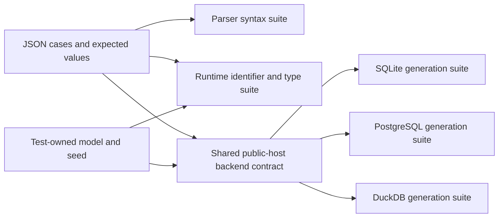

# Shared analytical SQL corpus

Each file in `cases/` is one executable contract. Its SQL, parameters and
expected semantic tree are independent of the parser implementation. Successful
cases also fix the logical result type and JSON values for every object in
`model.ts`. The parser never writes or updates these expectations.

| Expected phase | Contract                                                                                                                     |
| -------------- | ---------------------------------------------------------------------------------------------------------------------------- |
| `parse`        | Reject syntax outside the supported subset with the specified problem                                                        |
| `resolve`      | Parse the expected tree, then reject an unknown identifier or invalid typed value before SQL execution                       |
| `execute`      | Parse and resolve the expected type, then execute generated SQL on all three backends and return exactly the expected values |

Source spans are removed by `semanticQuery` only for the semantic-tree
comparison. The parser's separate tests verify original UTF-16 offsets, quoting
and parameter rewriting. Type and value expectations are handwritten, including
duplicates, empty/all-null input, int64 values beyond JavaScript's exact integer
range, and millisecond/microsecond timestamps. Booleans and binary-exact float
examples avoid depending on incidental decimal rounding differences.

The seed contains two objects sharing a key but having different `customerSince`
values, an empty key, an all-null key and a large-integer key. An unrelated key
is present only in the dataset: even `OR 1 = 1` must not include it. Physical
setup belongs to each connector's suite; the shared model and expected JSON do
not import either driver or any example application.



| Owner                | Suite                                                                                                         |
| -------------------- | ------------------------------------------------------------------------------------------------------------- |
| Parser               | `packages/sql-parser/test/parser.test.ts` compares every tree or parse rejection                              |
| Runtime analytics    | `packages/runtime/test/sql-corpus.test.ts` checks identifier resolution and inferred types for the same files |
| SQLite connector     | `connectors/sqlite/test/sql-corpus.test.ts` runs the public Node host over real generated SQLite SQL          |
| DuckDB connector     | `connectors/duckdb/test/sql-corpus.test.ts` runs the same backend contract over real DuckDB                   |
| PostgreSQL connector | `connectors/postgres/test/sql-corpus.integration.test.ts` runs the same backend contract over real PostgreSQL |

Every executable case runs as a caller expression. Cases without named
parameters also run as a declared property; named parameters are deliberately
invalid in declarations. Each case compares a full-evidence query with a
compact-evidence get, checks result metadata, and verifies statement counts.
Resolution failures must execute no statement. Rejected syntax is checked at
both parser and runtime preparation boundaries.

Run the complete corpus from the repository root:

```sh
pnpm build
pnpm exec dotenvx run -f .env -- vitest run \
  packages/sql-parser/test/parser.test.ts \
  packages/runtime/test/sql-corpus.test.ts \
  connectors/sqlite/test/sql-corpus.test.ts \
  connectors/duckdb/test/sql-corpus.test.ts \
  connectors/postgres/test/sql-corpus.integration.test.ts
```

`scalars.ts` separately fixes portable codec inputs and JSON encodings.
Multi-dataset grain, composite correlations, batch/page-size equivalence,
revocation, limits, cancellation and malformed driver results have separate
focused contracts; these case files do not claim to replace those tests.
[Generated SQL properties](../sql-properties/README.md) compare many generated
queries with a reference evaluator on SQLite and PostgreSQL.
