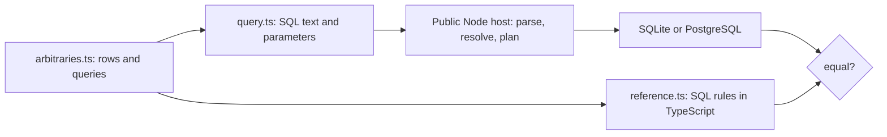

# Generated analytical SQL properties

A **property test** asserts a rule for many generated inputs instead of a few
handwritten ones. Here the rule is: a generated Relate SQL query over generated
dataset rows returns, for every customer, the value an independent **reference
evaluator** computes. Because each backend is checked against the same
reference, this is also a **differential test** between SQLite and PostgreSQL.
[fast-check](https://fast-check.dev) generates the cases and, on failure,
shrinks them to a minimal counterexample.



| File                  | Owns                                                                |
| --------------------- | ------------------------------------------------------------------- |
| `model.ts`            | Test-owned graph, fixed customers and the row shape                 |
| `arbitraries.ts`      | Value domains, predicate trees, aggregates and stored rows          |
| `query.ts`            | The generated query shape and its rendering to SQL with parameters  |
| `reference.ts`        | Three-valued logic, byte/instant ordering and aggregate results     |
| `backend-contract.ts` | Starts the Node host once and runs the property against one backend |

The domains are small on purpose, so equal values, NULLs and boundaries are
common: int64 values beyond 2^53, int32 limits, mixed-case and multibyte
strings, and timestamps stored with millisecond or microsecond text, compared
with offset spellings. Rows keyed `other` belong to no customer and must never
be counted. Float inputs are binary-exact; `AVG` and float64 `SUM` compare with
a relative tolerance because their last digits are documented backend
arithmetic.

Suites: `connectors/sqlite/test/sql-properties.test.ts` and
`connectors/postgres/test/sql-properties.integration.test.ts`. The PostgreSQL
column uses a locale collation, so byte ordering is actually exercised.

```sh
# More cases than the default 500
RELATE_PROPERTY_RUNS=5000 pnpm exec vitest run connectors/sqlite/test/sql-properties.test.ts

# Replay a reported failure with the seed and path from its report
RELATE_PROPERTY_SEED=-401370994 RELATE_PROPERTY_PATH="415:2:0" \
  pnpm exec vitest run connectors/sqlite/test/sql-properties.test.ts
```

The handwritten [SQL corpus](../sql-corpus/README.md) remains the readable
specification of individual cases; this suite looks for cases nobody wrote.
